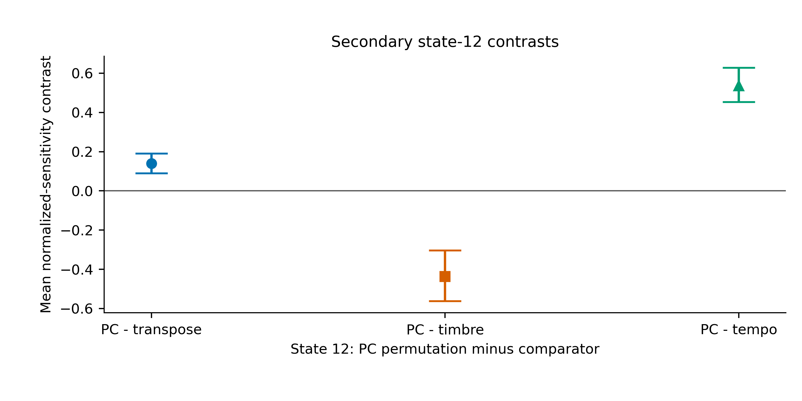
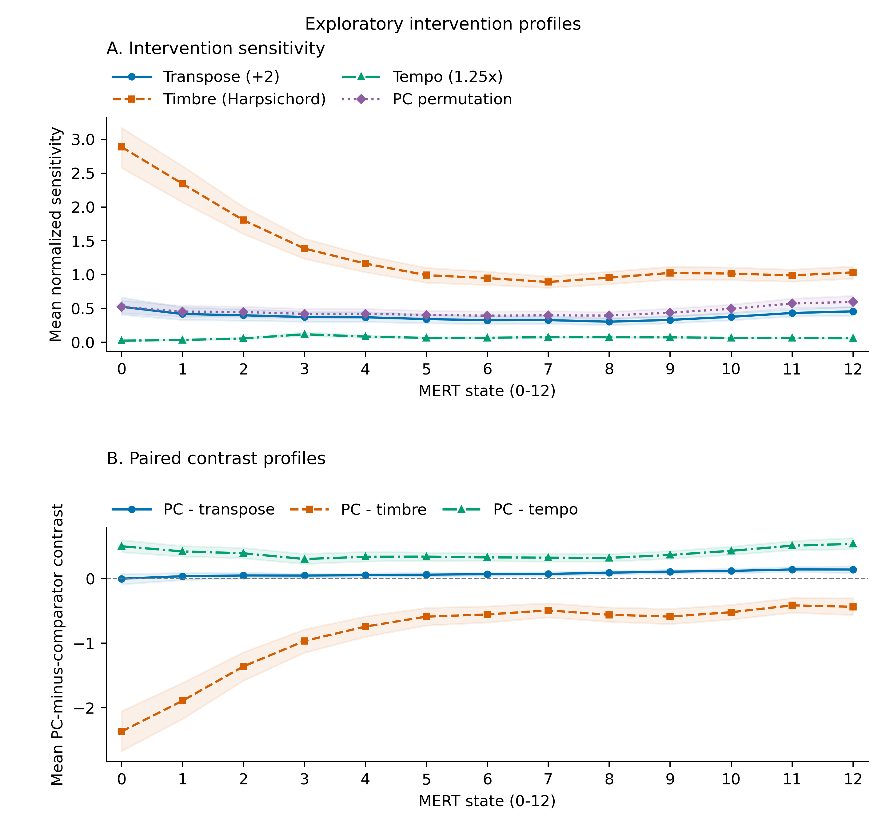
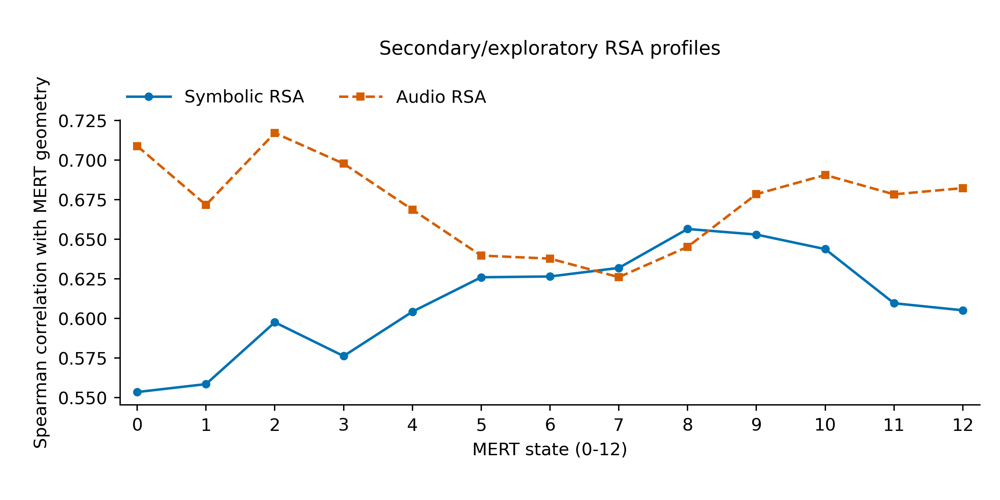

# Across Layers

## Auditing Symbolic and Acoustic Organization in a Pretrained Music Representation Model

**How does a pretrained music model respond to changes in pitch, instrument sound and tempo, and how does that response vary across layers?**

This completed research project audits a frozen MERT model through controlled interventions and across-piece similarity. The takeaway is **layer characterization is metric-dependent**: intervention selectivity and alignment with musical descriptors need not peak at the same layer. The study does not identify a universally best layer.

[Read the complete research report](RESEARCH_REPORT.pdf) · [Repository-readable report](RESEARCH_REPORT.md) · [Reproducibility and frozen source](docs/REPRODUCIBILITY.md)

## Study at a glance

- **Motivation:** a representation's response to a changed passage and its organization of different passages answer complementary questions about what it captures.
- **Sample:** 30 deterministically selected, quality-controlled MAESTRO v3 works; one frozen 20-second segment per work. This is not a probability-representative sample.
- **Design:** original plus four independent interventions: +2 semitones, piano-to-harpsichord preset substitution, 150 BPM (1.25× faster), and a fixed octave-preserving pitch-class permutation. Faster-tempo clips retain their natural 16-second duration.
- **Model:** pinned MERT-v1-95M; all 13 returned states, whole-clip mean pooling. No training or fine-tuning. The formal dataset contains 150 instances; repeat extractions serve only as reproducibility checks.
- **Measurements:** within-piece cosine changes normalized by same-state between-piece original distances; separately, representational similarity analysis (RSA) of original pieces against symbolic and audio descriptors.

## What the frozen results show

**PRIMARY, state 12: non-confirming under the specified test.** Pitch-class-permutation sensitivity minus the mean of the other three sensitivities was **0.0799**, with bootstrap 95% CI **[0.0057, 0.1630]** and sign-flip **p = 0.0596**. The positive interval does not override the non-confirming test. [Exact result](results/primary_result.json).

**SECONDARY:** pitch-class permutation produced greater sensitivity than transposition or tempo, but less than timbre. All three secondary null hypotheses were rejected after Holm adjustment. Their exact inference was clarified after primary/descriptive inspection, before secondary inference.



*Figure 1. Unadjusted bootstrap intervals; these secondary contrasts do not replace the primary endpoint.*

**EXPLORATORY:** the piano-to-harpsichord preset substitution had the largest mean sensitivity at every state. Pitch-class-versus-transposition separation grew overall with local reversals; the profiles do not establish a monotonic symbolic hierarchy.



*Figure 2. All states retained; intervals are descriptive, not layer-wise significance tests.*

**SECONDARY / EXPLORATORY RSA:** both symbolic and audio descriptor geometries were positively associated with MERT across states. Their different depth profiles characterize alignment, not intervention selectivity. No statistical comparison established symbolic superiority or an optimal state.



*Figure 3. Individual descriptor-association tests, not tests of differences between descriptors or layers. [Full captions and provenance](figures/CAPTIONS.md).*

## Post-freeze robustness

**POST-FREEZE / POST-HOC / EXPLORATORY:** the completed raw-distance alternative had mean **0.0074698741**, sign-flip **p = 0.02539746**. Leave-one-piece-out normalized p-values ranged **0.029897–0.114089** with fixed original denominators. All-state raw/reference/normalized summaries are retained. Threshold crossing depends on normalization/reference choice and finite sample composition; this does **not** retroactively confirm the original normalized primary. Read the [robustness summary and limitations](docs/ROBUSTNESS.md).

## Limits of the conclusions

- **N=30 works**, one deterministic passage per work; selection was outcome-independent and quality-controlled, not probability-representative.
- Interventions are not perceptually/acoustically magnitude-matched. The fixed octave-preserving pitch-class permutation probes selected pitch relations, not all symbolic structure.
- Tempo is confounded with duration. `tempo150` means **150 BPM = 1.25× faster than 120 BPM**, retaining natural 16-second audio.
- Audio is synthetic **FluidSynth/TimGM6mb** rendering; findings do not establish behavior on natural recordings. Whole-clip mean pooling compresses temporal information.
- Normalized sensitivity is a **reference-relative audit metric**. The percentile bootstrap interval and sign-flip test are different procedures; the positive interval does not override the non-confirming primary test.
- No universally optimal MERT layer was statistically established. RSA does not establish symbolic superiority, and post-hoc residualization does not establish causal symbolic/acoustic separation.

## Verify and explore

CPU-only verification uses Python with NumPy (recorded version 1.26.4):

```sh
python scripts/verify_results.py
python -m pytest -q
```

The verifier checks scientific schemas, piece mappings, saved results and exact formal state-12 distances from the small bundled vector export. Pytest validates calculations. Documentation and report edits do not require hash synchronization. It runs no model inference or hypothesis tests. Large source/model caches are not included; this is not a promise of one-command full MERT re-inference. See [reproduction instructions](docs/REPRODUCIBILITY.md).

Read first: [research report](RESEARCH_REPORT.pdf), [methods and evidence boundaries](docs/METHODS.md), [robustness](docs/ROBUSTNESS.md), and [dataset/model attribution](docs/ATTRIBUTION.md). Inspect the [formal sample](results/sample_manifest.csv), [dataset manifest](results/dataset_manifest.csv), and [frozen result provenance](results/provenance.json).

The formal no-clipping metric is [src/scientific_metrics.py](src/scientific_metrics.py). The retained [src/distances.py](src/distances.py) is a historical engineering smoke helper, not the reported scientific metric.

**Supplementary only:** [Figure 4](figures/figure4_posthoc_overlap.pdf) and [descriptor-overlap notes](docs/SUPPLEMENTARY.md). This post-hoc analysis was proposed after RSA inspection and supports no significance or causal claims.

The PDF is the manually maintained research report; [RESEARCH_REPORT.tex](RESEARCH_REPORT.tex) is its source snapshot, with no local compilation requirement. This repository retains a curated reproducible subset of the study; Git records its version history.
